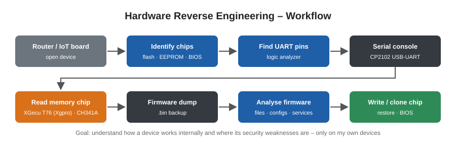

# 03 – Hardware Reverse Engineering of Routers & IoT Devices (09/2026)

## What I did
- Located debug interfaces (**UART**) on router and IoT boards and connected via a **CP2102** USB-UART adapter
- Read firmware from **SPI flash** chips with a **CH341A** programmer
- Read, wrote and cloned memory chips (EEPROM, SPI flash, **BIOS chips**) with an **XGecu T76** programmer (Xgpro software)
- Used a **logic analyzer** to inspect signals
- Analysed the extracted firmware and devices for security weaknesses

## Skills shown
Embedded hardware · firmware extraction · chip programming · IoT security · electronics (Elektroniker + B.E.)
